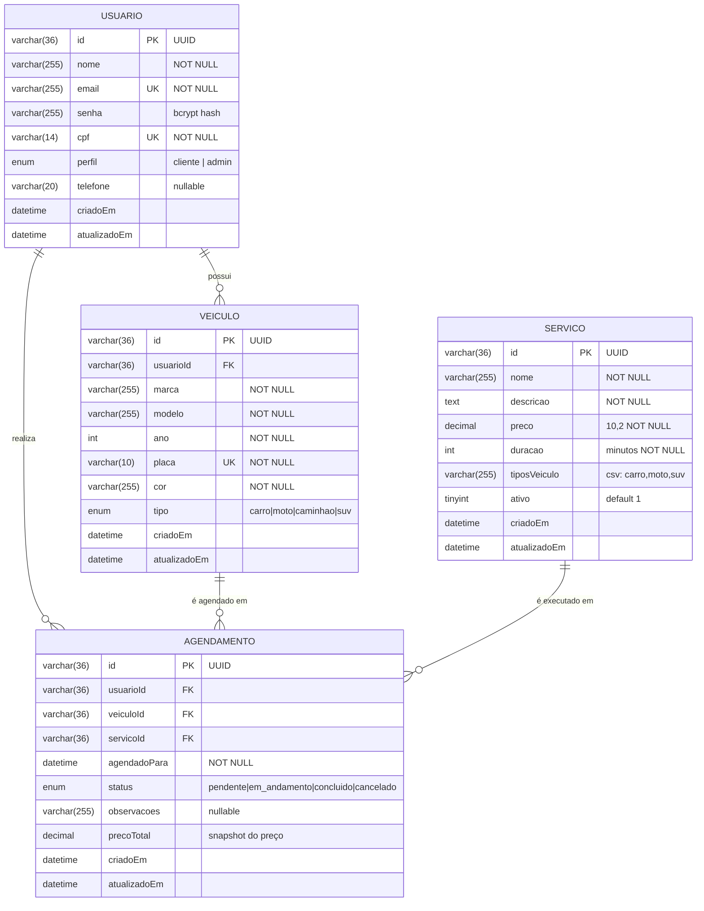

# 2. Diagrama Entidade-Relacionamento (DER)

## 2.1 Diagrama

## 2.2 Descrição das Entidades

### USUARIO
Representa qualquer pessoa cadastrada no sistema. O campo `perfil` distingue clientes comuns de administradores. Email e CPF possuem restrição `UNIQUE` para evitar cadastros duplicados. A senha é armazenada como hash bcrypt (12 rounds) — nunca em texto simples.

### VEICULO
Pertence a um único `USUARIO` (FK `usuarioId`). A placa é única no sistema. O campo `tipo` é um `ENUM` que restringe os valores válidos e é usado para filtrar quais serviços estão disponíveis para aquele veículo. A exclusão do usuário propaga-se em cascata para seus veículos.

### SERVICO
Gerenciado somente pelo administrador. O campo `tiposVeiculo` armazena uma string CSV (ex.: `"carro,suv"`) indicando para quais tipos de veículo o serviço está disponível. O campo `ativo` permite desativar serviços sem excluí-los do histórico.

### AGENDAMENTO
É a entidade central do sistema. Registra a relação entre `USUARIO`, `VEICULO` e `SERVICO` num determinado horário. O campo `precoTotal` é um **snapshot** do preço do serviço no momento do agendamento — variações futuras de preço não afetam agendamentos já criados. O campo `status` segue o ciclo de vida: `pendente` → `em_andamento` → `concluido` (ou `cancelado`).

## 2.3 Regras de Integridade

| Regra | Implementação |
|-------|---------------|
| Email único por usuário | `UNIQUE KEY usuario_email_unique` |
| CPF único por usuário | `UNIQUE KEY usuario_cpf_unique` |
| Placa única por veículo | `UNIQUE KEY veiculo_placa_unique` |
| Exclusão de usuário apaga veículos e agendamentos | `ON DELETE CASCADE` nas FKs |
| Exclusão de veículo apaga seus agendamentos | `ON DELETE CASCADE` |
| Serviço não pode ser excluído se referenciado | `ON DELETE CASCADE` (mantém histórico via precoTotal) |
| Conflito de horário | Verificado na camada de serviço (AgendamentoService) |
