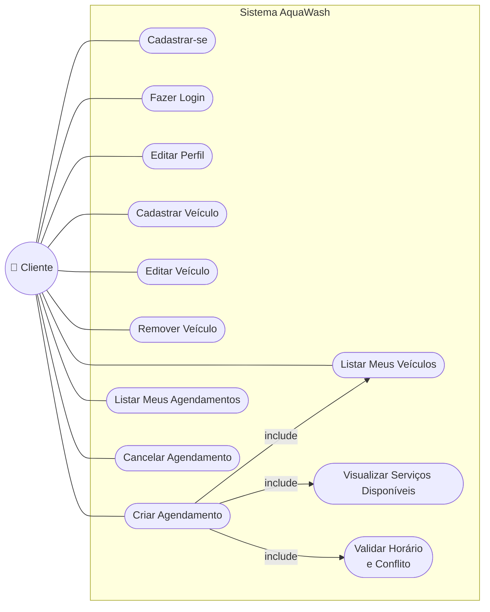
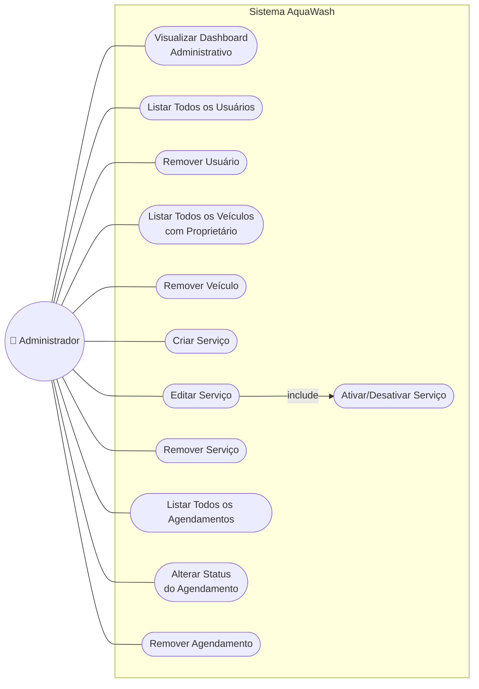
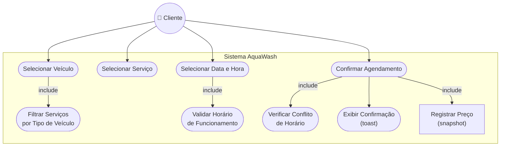

# 4. Diagramas de Casos de Uso

Os diagramas abaixo estão em sintaxe **Mermaid** e podem ser visualizados no GitHub, VS Code (extensão Mermaid) ou em [mermaid.live](https://mermaid.live).

---

## 4.1 Caso de Uso 1 — Módulo do Cliente

Este diagrama cobre todas as funcionalidades disponíveis para um usuário com perfil **cliente**.

### Descrição dos Casos de Uso — Cliente

| ID    | Nome | Ator | Pré-condição | Pós-condição |
|-------|------|------|--------------|--------------|
| UC-01 | Cadastrar-se | Visitante | Nenhuma | Conta criada; usuário pode fazer login |
| UC-02 | Fazer Login | Visitante | Conta existente | Token JWT emitido; usuário redirecionado ao dashboard |
| UC-03 | Editar Perfil | Cliente autenticado | Login realizado | Dados pessoais atualizados |
| UC-04 | Cadastrar Veículo | Cliente autenticado | Login realizado | Veículo vinculado ao usuário |
| UC-05 | Editar Veículo | Cliente autenticado | Veículo próprio cadastrado | Dados do veículo atualizados (exceto placa) |
| UC-06 | Remover Veículo | Cliente autenticado | Veículo próprio cadastrado | Veículo e seus agendamentos removidos |
| UC-07 | Listar Meus Veículos | Cliente autenticado | Login realizado | Lista paginada de veículos exibida |
| UC-08 | Criar Agendamento | Cliente autenticado | Ao menos 1 veículo cadastrado; serviço ativo disponível | Agendamento criado com status "pendente" |
| UC-09 | Listar Meus Agendamentos | Cliente autenticado | Login realizado | Lista paginada de agendamentos exibida |
| UC-10 | Cancelar Agendamento | Cliente autenticado | Agendamento com status "pendente" | Status alterado para "cancelado" |
| UC-11 | Visualizar Serviços Disponíveis | Cliente autenticado | Veículo selecionado | Serviços compatíveis com o tipo do veículo listados |

---

## 4.2 Caso de Uso 2 — Módulo do Administrador

Este diagrama cobre todas as funcionalidades disponíveis para um usuário com perfil **admin**.

### Descrição dos Casos de Uso — Administrador

| ID    | Nome | Pré-condição | Pós-condição |
|-------|------|--------------|--------------|
| UA-01 | Visualizar Dashboard | Login como admin | Estatísticas (totais) e agendamentos recentes exibidos |
| UA-02 | Listar Todos os Usuários | Login como admin | Lista paginada com nome, e-mail e perfil exibida |
| UA-03 | Remover Usuário | Login como admin; usuário existente | Usuário, veículos e agendamentos removidos em cascata |
| UA-04 | Listar Todos os Veículos | Login como admin | Lista paginada com nome e e-mail do proprietário exibida |
| UA-05 | Remover Veículo | Login como admin | Veículo e seus agendamentos removidos |
| UA-06 | Criar Serviço | Login como admin | Novo serviço ativo disponível para agendamento |
| UA-07 | Editar Serviço | Login como admin; serviço existente | Dados do serviço atualizados |
| UA-08 | Ativar/Desativar Serviço | Login como admin; serviço existente | Visibilidade do serviço alterada para clientes |
| UA-09 | Remover Serviço | Login como admin | Serviço removido do sistema |
| UA-10 | Listar Todos os Agendamentos | Login como admin | Lista paginada de todos os agendamentos exibida |
| UA-11 | Alterar Status do Agendamento | Login como admin | Status do agendamento atualizado |
| UA-12 | Remover Agendamento | Login como admin | Agendamento excluído permanentemente |

---

## 4.3 Caso de Uso 3 — Fluxo de Agendamento (detalhado)

Este diagrama detalha as interações do caso de uso central: **Criar Agendamento**.

