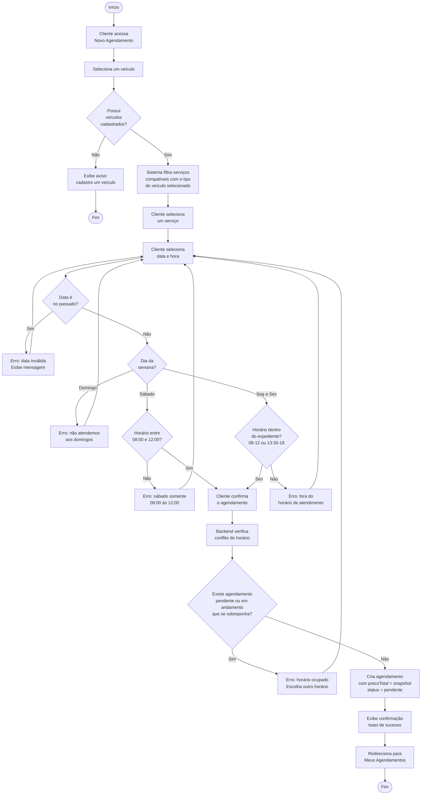
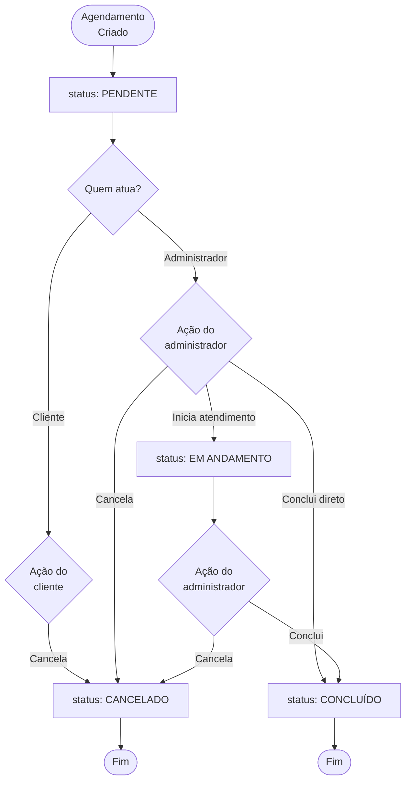
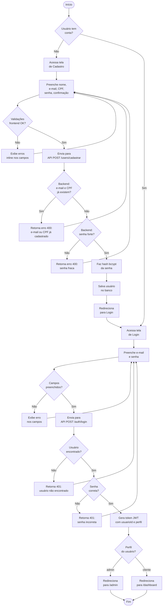
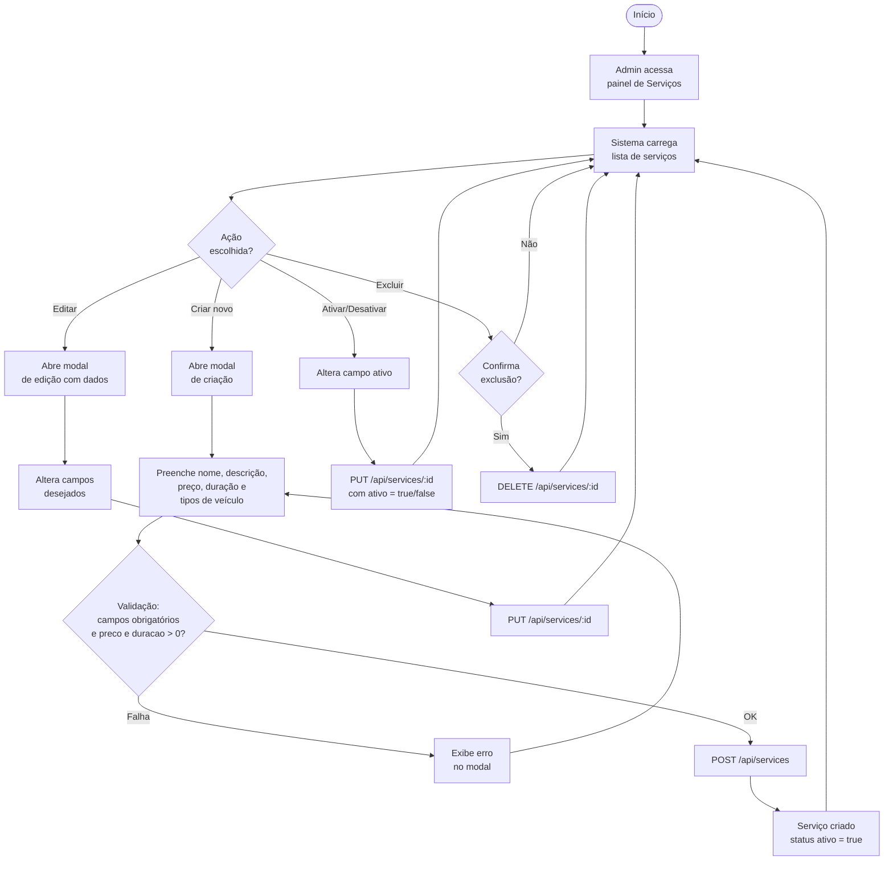

# 5. Diagramas de Atividades (Fluxogramas de Regras de Negócio)

Os diagramas abaixo representam os principais fluxos de atividades do sistema, incluindo as regras de negócio aplicadas em cada etapa.

---

## 5.1 Diagrama de Atividades — Processo de Agendamento

Este fluxograma representa a regra de negócio mais complexa do sistema: a criação de um agendamento, com todas as validações envolvidas.

---

## 5.2 Diagrama de Atividades — Ciclo de Vida do Agendamento

Este fluxograma representa as transições de estado possíveis para um agendamento ao longo do tempo.

---

## 5.3 Diagrama de Atividades — Cadastro e Autenticação

Este fluxograma cobre o processo de cadastro de novo usuário e posterior login, incluindo as validações de segurança.

---

## 5.4 Diagrama de Atividades — Gerenciamento de Serviços pelo Administrador

