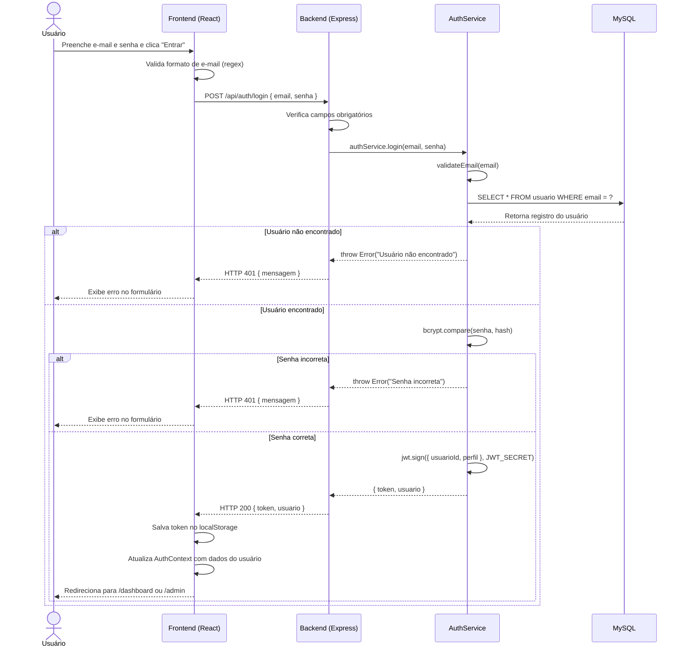
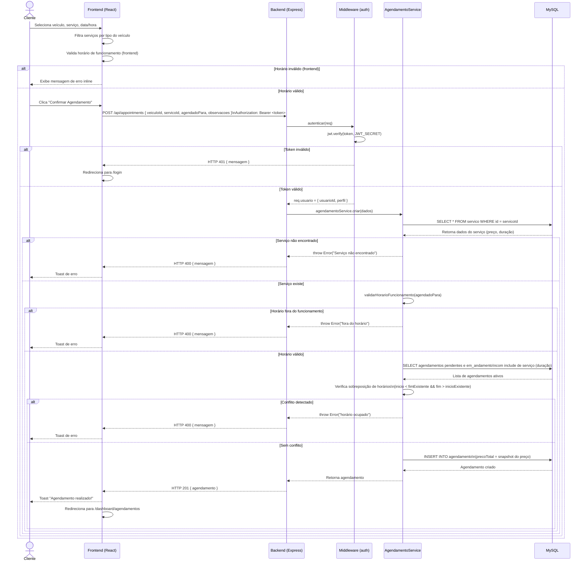
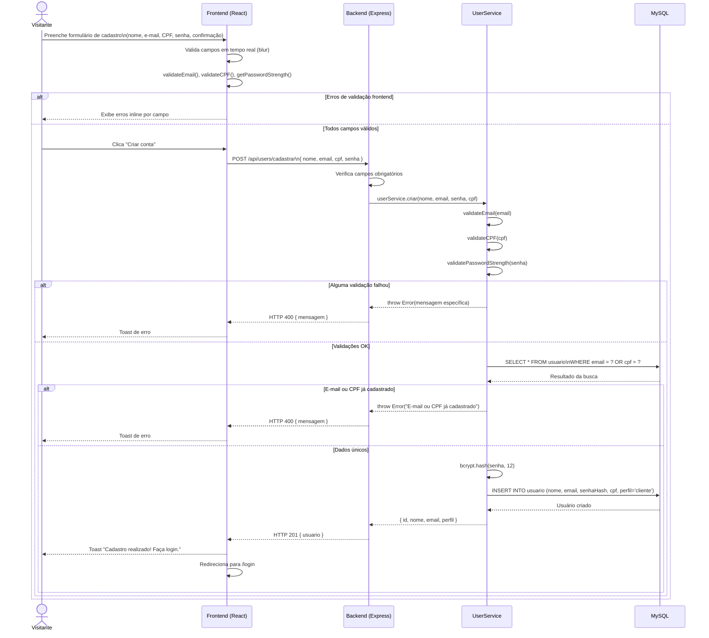
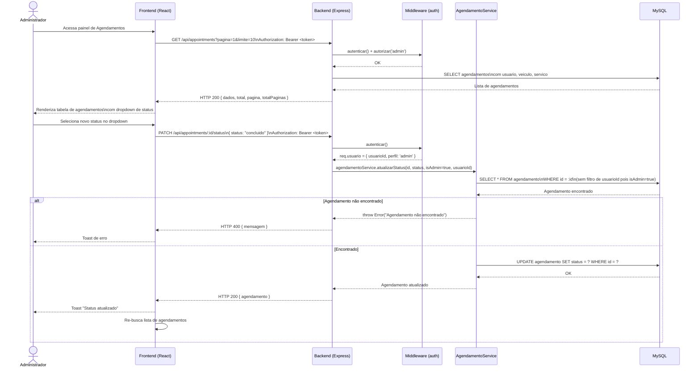

# 6. Diagramas de Sequência

Os diagramas representam o fluxo de mensagens entre os atores e as camadas do sistema para as principais funcionalidades.

---

## 6.1 Diagrama de Sequência — Login de Usuário

---

## 6.2 Diagrama de Sequência — Criação de Agendamento

---

## 6.3 Diagrama de Sequência — Cadastro de Usuário

---

## 6.4 Diagrama de Sequência — Alteração de Status pelo Administrador

