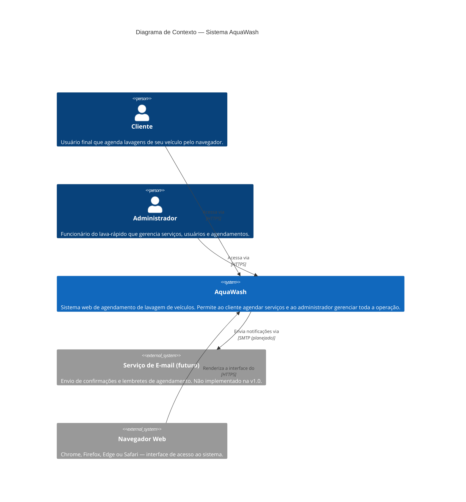
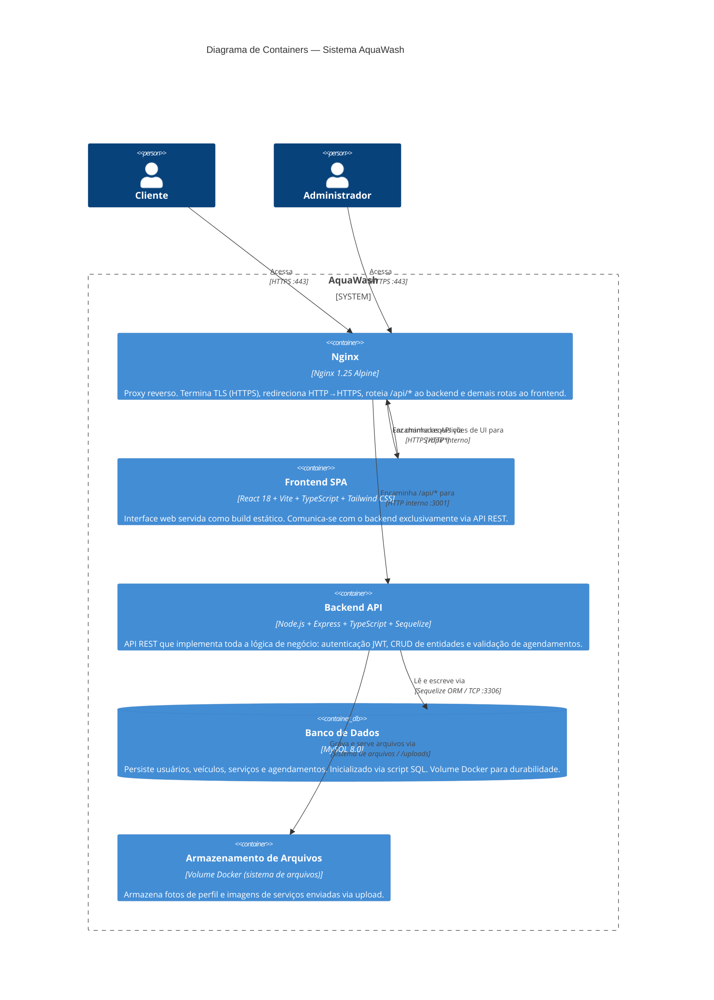

# 7. Diagramas C4 — Contexto e Containers

Os diagramas C4 descrevem a arquitetura do sistema em dois níveis de abstração: **Contexto** (visão macro, quem usa o sistema e com o que ele se integra) e **Containers** (visão interna, quais peças de software compõem o sistema).

---

## 7.1 Nível 1 — Diagrama de Contexto

Mostra o sistema AquaWash como uma caixa preta e os atores/sistemas externos ao redor.

---

## 7.2 Nível 2 — Diagrama de Containers

Mostra os containers (processos/aplicações) que compõem o sistema AquaWash e como eles se comunicam.

---

## 7.3 Decisões de Design Refletidas nos Diagramas

| Decisão | Justificativa |
|---------|---------------|
| Nginx como único ponto de entrada | Centraliza TLS, headers de segurança e roteamento, evitando exposição direta dos serviços internos. |
| Frontend como SPA estática | Permite servir via Nginx sem Node.js em produção; build otimizado pelo Vite. |
| Backend isolado na rede interna Docker | Nunca exposto diretamente ao host; acessível apenas pelo Nginx. |
| MySQL com volume nomeado | Garante persistência de dados mesmo após restart/recriação do container. |
| Uploads em volume separado | Isola dados binários do banco relacional; facilita backup independente. |
