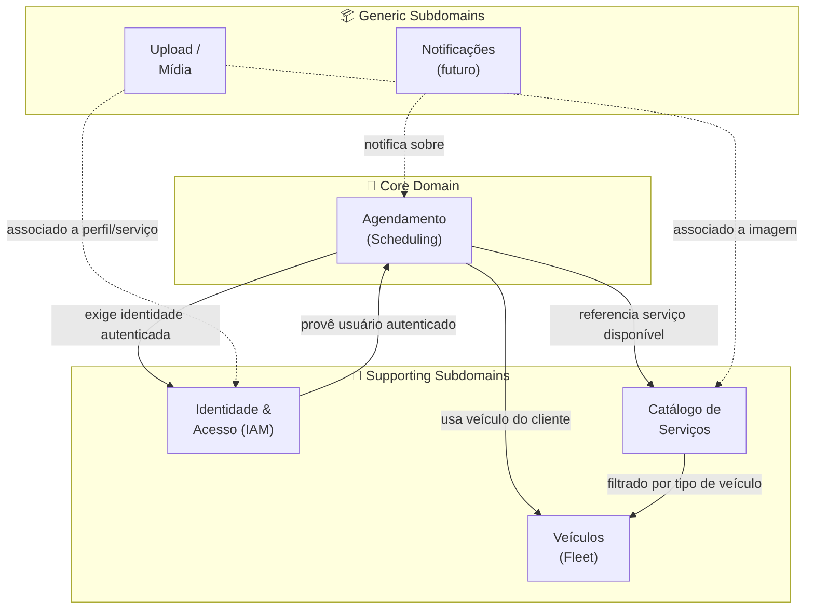

# 10. Domain-Driven Design (DDD) — AquaWash

---

## 10.1 Context Map — Domínios e Subdomínios

O Context Map identifica os domínios do sistema e como eles se relacionam entre si.



### Classificação dos Domínios

| Domínio | Tipo | Justificativa |
|---|---|---|
| **Agendamento** | Core Domain | É o coração do negócio — diferencial competitivo do sistema. Toda a lógica de conflito de horário, regras de funcionamento e ciclo de vida do agendamento vive aqui. |
| **Identidade & Acesso** | Supporting | Necessário para o negócio funcionar, mas não é o diferencial. Implementado internamente com JWT + bcrypt. |
| **Veículos** | Supporting | Suporta o agendamento ao identificar o tipo de veículo, determinando quais serviços estão disponíveis. |
| **Catálogo de Serviços** | Supporting | Gerenciado pelo admin; define o que pode ser agendado e a que preço. |
| **Upload / Mídia** | Generic | Solução genérica de armazenamento de arquivos, sem lógica de negócio específica. |
| **Notificações** | Generic | Previsto para versões futuras; sem implementação na v1.0. |

---

## 10.2 Bounded Contexts

### BC-01 — Agendamento (Scheduling Context)

**Responsabilidade:** Gerenciar todo o ciclo de vida de um agendamento — criação, validação de regras de negócio, transições de status e cancelamento.

**Fronteiras:** Recebe referências a `usuarioId`, `veiculoId` e `servicoId`, mas não conhece os detalhes internos desses contextos — apenas os IDs e os dados necessários para suas regras (tipo do veículo, duração e preço do serviço).

**Regras de negócio contidas:**
- Validação de horário de funcionamento (Seg–Sex 08–12/13:30–18, Sáb 08–12, fechado Dom)
- Detecção de conflito de horário (sobreposição por duração)
- Snapshot de preço no momento da criação
- Ciclo de vida: `pendente → em_andamento → concluido | cancelado`
- Cliente só pode cancelar agendamentos com status `pendente`
- Admin pode alterar para qualquer status

**Interfaces expostas:**
- `POST /api/appointments` — criar agendamento
- `GET /api/appointments/meus` — listar agendamentos do cliente
- `GET /api/appointments` — listar todos (admin)
- `GET /api/appointments/slots` — slots disponíveis
- `PATCH /api/appointments/:id/status` — atualizar status
- `DELETE /api/appointments/:id` — excluir

---

### BC-02 — Identidade & Acesso (IAM Context)

**Responsabilidade:** Cadastro, autenticação e autorização de usuários. Emissão e validação de tokens JWT.

**Fronteiras:** Produz o `usuarioId` e o `perfil` que os demais contextos consomem via token JWT. Não conhece agendamentos nem veículos.

**Regras de negócio contidas:**
- Validação de e-mail (regex), CPF (algoritmo dígitos verificadores) e força de senha
- E-mail e CPF únicos no sistema
- Hash bcrypt (12 rounds) para senhas
- Token JWT com expiração de 7 dias
- E-mail não pode ser alterado após cadastro

**Interfaces expostas:**
- `POST /api/auth/login`
- `POST /api/users/cadastrar`
- `GET /api/users/:id`
- `PUT /api/users/:id`
- `GET /api/users` (admin)
- `DELETE /api/users/:id` (admin)

---

### BC-03 — Veículos (Fleet Context)

**Responsabilidade:** Cadastro e gerenciamento dos veículos dos clientes.

**Fronteiras:** Veículo pertence a um `usuarioId`. O tipo do veículo (`carro | moto | caminhao | suv`) é consumido pelo contexto de Agendamento para filtrar serviços compatíveis.

**Regras de negócio contidas:**
- Placa única no sistema
- Placa não pode ser alterada após cadastro
- Cliente só acessa seus próprios veículos
- Admin visualiza todos com informação do proprietário
- Exclusão do usuário propaga-se em cascata para seus veículos

**Interfaces expostas:**
- `GET /api/vehicles/meus`
- `GET /api/vehicles` (admin)
- `POST /api/vehicles`
- `PUT /api/vehicles/:id`
- `DELETE /api/vehicles/:id`

---

### BC-04 — Catálogo de Serviços (Service Catalog Context)

**Responsabilidade:** Gerenciamento dos serviços oferecidos pelo lava-rápido.

**Fronteiras:** Serviço define preço e duração, consumidos pelo contexto de Agendamento como snapshot. O campo `tiposVeiculo` (CSV) é consumido pelo frontend para filtrar serviços compatíveis com o tipo do veículo.

**Regras de negócio contidas:**
- Apenas admin cria/edita/exclui serviços
- Serviços podem ser ativados/desativados sem exclusão (soft disable)
- Apenas serviços ativos aparecem para o cliente no agendamento
- Filtro por tipo de veículo compatível

**Interfaces expostas:**
- `GET /api/services` — serviços ativos (público)
- `GET /api/services/admin/todos` — todos os serviços (admin)
- `POST /api/services` (admin)
- `PUT /api/services/:id` (admin)
- `DELETE /api/services/:id` (admin)

---

## 10.3 Entities, Value Objects e Aggregates

O foco deste detalhamento é o **BC-01 — Agendamento**, por ser o Core Domain.

### Aggregate: Agendamento

O `Agendamento` é o **Aggregate Root** do contexto de agendamento. Ele encapsula as regras de negócio mais complexas do sistema.

```
┌─────────────────────────────────────────────────────────┐
│                 AGGREGATE: Agendamento                  │
│                 (Aggregate Root: Agendamento)            │
│                                                         │
│  ┌──────────────────────────────────────────────────┐   │
│  │  Entity: Agendamento                             │   │
│  │  - id: UUID                                      │   │
│  │  - usuarioId: UUID (referência externa)          │   │
│  │  - veiculoId: UUID (referência externa)          │   │
│  │  - servicoId: UUID (referência externa)          │   │
│  │  - agendadoPara: DateTime                        │   │
│  │  - status: StatusAgendamento (VO)                │   │
│  │  - observacoes: string?                          │   │
│  │  - precoTotal: Dinheiro (VO)                     │   │
│  │  - criadoEm: DateTime                            │   │
│  │  - atualizadoEm: DateTime                        │   │
│  └──────────────────────────────────────────────────┘   │
│                                                         │
│  ┌──────────────────────────────────────────────────┐   │
│  │  Value Object: StatusAgendamento                 │   │
│  │  Valores válidos:                                │   │
│  │  - pendente                                      │   │
│  │  - em_andamento                                  │   │
│  │  - concluido                                     │   │
│  │  - cancelado                                     │   │
│  │  Regra: transições válidas definidas no service  │   │
│  └──────────────────────────────────────────────────┘   │
│                                                         │
│  ┌──────────────────────────────────────────────────┐   │
│  │  Value Object: Dinheiro (precoTotal)             │   │
│  │  - valor: Decimal(10,2)                          │   │
│  │  - Imutável após criação (snapshot de preço)     │   │
│  └──────────────────────────────────────────────────┘   │
│                                                         │
│  ┌──────────────────────────────────────────────────┐   │
│  │  Value Object: HorarioFuncionamento              │   │
│  │  Regras encapsuladas:                            │   │
│  │  - Seg–Sex: 08:00–12:00 e 13:30–18:00           │   │
│  │  - Sábado: 08:00–12:00                           │   │
│  │  - Domingo: fechado                              │   │
│  └──────────────────────────────────────────────────┘   │
└─────────────────────────────────────────────────────────┘
```

### Entities

| Entity | Contexto | Identidade | Descrição |
|---|---|---|---|
| **Agendamento** | BC-01 | UUID gerado | Aggregate root do contexto de agendamento. Ciclo de vida gerenciado pelo `AgendamentoService`. |
| **Usuario** | BC-02 | UUID gerado | Aggregate root do contexto IAM. Carrega perfil (cliente/admin) que determina permissões. |
| **Veiculo** | BC-03 | UUID gerado | Pertence a um Usuario. Identidade persistida; placa imutável após criação. |
| **Servico** | BC-04 | UUID gerado | Aggregate root do catálogo. Pode ser desativado sem perder histórico em agendamentos existentes. |

### Value Objects

| Value Object | Contexto | Imutável? | Descrição |
|---|---|---|---|
| **StatusAgendamento** | BC-01 | Sim | Enum com os 4 estados do agendamento. Sem identidade própria — faz parte do Agendamento. |
| **PrecoTotal** | BC-01 | Sim | Snapshot do preço do serviço no momento da criação. Nunca recalculado. |
| **HorarioFuncionamento** | BC-01 | Sim | Encapsula as regras de horário de atendimento verificadas pelo `AgendamentoService`. |
| **TipoVeiculo** | BC-03/04 | Sim | Enum `carro | moto | caminhao | suv`. Usado para filtrar serviços compatíveis. |
| **Email** | BC-02 | Sim | Validado por regex; imutável após cadastro. |
| **CPF** | BC-02 | Sim | Validado pelo algoritmo de dígitos verificadores. |
| **SenhaHash** | BC-02 | Sim | Hash bcrypt (12 rounds). Nunca armazenada em texto simples. |

### Domain Services

| Service | Contexto | Responsabilidade |
|---|---|---|
| **AgendamentoService** | BC-01 | Orquestra criação de agendamento: valida horário de funcionamento, detecta conflitos, captura snapshot de preço, persiste. |
| **AuthService** | BC-02 | Login: valida credenciais, compara hash bcrypt, emite JWT. |
| **UserService** | BC-02 | Cadastro: valida e-mail, CPF, força de senha; cria hash bcrypt; verifica unicidade. |
| **ServicoService** | BC-04 | CRUD de serviços; filtragem por tipo de veículo e status ativo. |
| **VeiculoService** | BC-03 | CRUD de veículos; isolamento por usuário; validação de placa única. |
