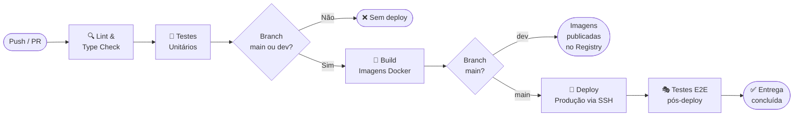

# 13. Estratégia de Deploy e Entrega Contínua

---

## 13.1 Visão Geral do Pipeline CI/CD

O pipeline está definido em `.github/workflows/ci-cd.yml` e segue o fluxo abaixo:



### Estágios do Pipeline

| Estágio | Trigger | O que faz | Bloqueia se falhar? |
|---|---|---|---|
| **Lint & Type Check** | Todo push/PR | `tsc --noEmit` backend e frontend | ✅ Sim |
| **Testes Unitários** | Após lint | `jest --coverage` no backend | ✅ Sim |
| **Build Docker** | Após testes (main/dev) | Builda e publica imagens no GHCR | ✅ Sim |
| **Deploy Produção** | Apenas branch `main` | SSH → `docker compose pull` + `up -d` | ✅ Sim |
| **Testes E2E** | Após deploy (main) | Playwright em ambiente de produção | ⚠️ Alerta (não bloqueia rollback automático) |

---

## 13.2 Estratégia de Deploy

### Deploy Adotado: Rolling Update com Rollback Manual

Para o porte do projeto (ambiente single-server com Docker Compose), a estratégia escolhida é um **rolling update simples com capacidade de rollback rápido** via tags de imagem Docker.

#### Sequência de Deploy

```
1. docker compose pull backend      # baixa nova imagem
2. docker compose up -d --no-deps backend   # sobe novo container
3. Aguarda 15s + verifica healthcheck       # garante que subiu saudável
4. docker compose up -d --no-deps frontend  # sobe novo frontend
5. docker exec nginx nginx -s reload        # reload Nginx sem downtime
```

Cada serviço é atualizado individualmente. O Nginx continua servindo requisições durante a troca do backend (janela de ~15 segundos de transição).

---

### Rollback

Toda imagem publicada recebe duas tags:
- `latest` — sempre a versão mais recente
- `<git-sha>` — tag imutável do commit exato

**Procedimento de rollback:**

```bash
# 1. Identificar o SHA da versão estável anterior
docker images ghcr.io/<org>/aquawash/backend

# 2. Editar docker-compose.yml para usar a tag do SHA anterior
#    image: ghcr.io/<org>/aquawash/backend:<sha-anterior>

# 3. Aplicar rollback
docker compose up -d --no-deps backend
docker compose up -d --no-deps frontend

# 4. Verificar
docker compose ps
docker logs aquawash_backend --tail 20
```

**Tempo estimado de rollback:** < 2 minutos

---

### Ambientes

| Ambiente | Branch | Deploy | URL |
|---|---|---|---|
| **Desenvolvimento** | qualquer | Manual (`npm run dev`) | `http://localhost:5173` |
| **Staging** | `dev` | Imagens publicadas no GHCR (sem deploy automático) | — |
| **Produção** | `main` | Automático via pipeline | `https://meuapp.local` |

---

## 13.3 Segredos Necessários no GitHub

Configure estes segredos em **Settings → Secrets and variables → Actions**:

| Segredo | Descrição |
|---|---|
| `DEPLOY_HOST` | IP ou hostname do servidor de produção |
| `DEPLOY_USER` | Usuário SSH do servidor |
| `DEPLOY_SSH_KEY` | Chave privada SSH (par com a pública no servidor) |
| `VITE_API_URL` | URL da API em produção (ex.: `https://meuapp.local/api`) |
| `PRODUCTION_URL` | URL base para os testes E2E |
| `E2E_TEST_EMAIL` | E-mail de usuário de teste para E2E |
| `E2E_TEST_PASSWORD` | Senha do usuário de teste para E2E |

---

## 13.4 Branches e Fluxo Git

```
main    ─────────────────────────────── (produção, protegida)
          ↑ merge via PR com aprovação
dev     ──────────────────────────────  (integração)
          ↑ merge via PR
feature/  (branches de funcionalidades — padrão: feature/<descricao>)
fix/      (branches de correção — padrão: fix/<descricao>)
```

**Regras:**
- `main` só recebe código via Pull Request aprovado
- Commits seguem Conventional Commits (validado pelo Husky + commitlint)
- Nenhum commit vai direto para `main`
